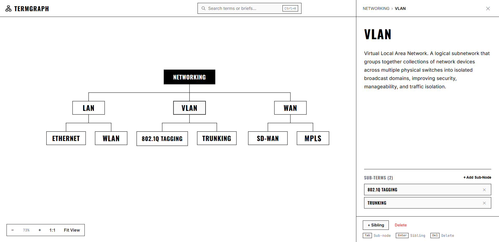

# TermGraph

A minimal, high-performance hierarchical knowledge graph for structured terms and concepts.



## Quick Start

```bash
npm install
npm run dev
```

Open [http://localhost:5173](http://localhost:5173) in your browser.

## Features

- **Orthogonal Tree Routing**: Linear-time layout powered by `d3-hierarchy` with non-scaling 1px vector lines.
- **Drafting Aesthetic**: Strict 0px border-radius, zero drop-shadows, and dynamic inverted root node.
- **Permanent Local Storage**: Syncs directly to `data/knowledge-base.json` with browser `localStorage` mirror.
- **Themes & Font Packs**: 6 color presets (Dark, Light, Parchment, Nordic, Solarized, Monochrome) and 5 curated font pairings.
- **Search & Inspector**: Instant filtering (`Ctrl+K`) and click-to-edit side panel for term definitions and sub-nodes.
- **Undo / Redo**: Lightweight snapshot history (`Ctrl+Z` / `Ctrl+Y`) with debounced typing.

## Shortcuts

- `Ctrl+K` or `/`: Search
- `Ctrl+Z` / `Ctrl+Y`: Undo / Redo
- `0` / `1`: Fit to screen / 1:1 view
- `+` / `-`: Zoom in / Zoom out
- `Tab` / `Enter`: Add child / sibling
- `Delete`: Delete selected node
- `Esc`: Close panels

## License

[MIT](LICENSE)
